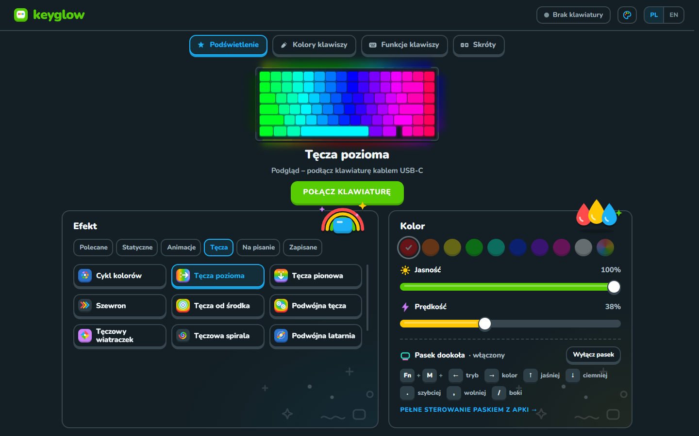
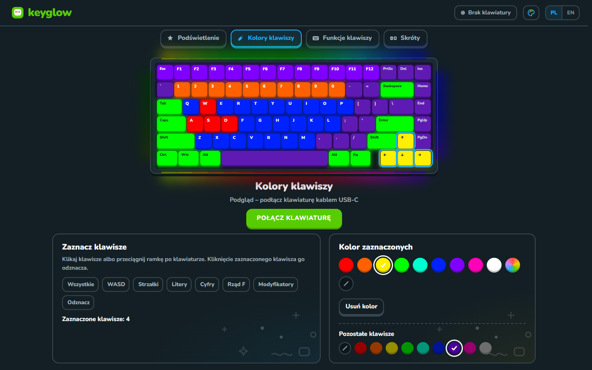
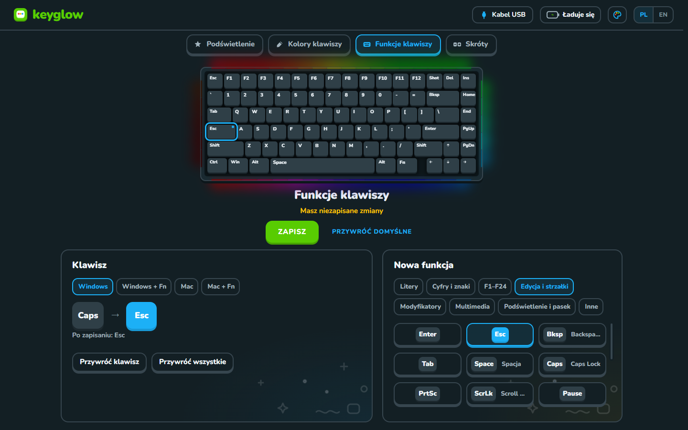
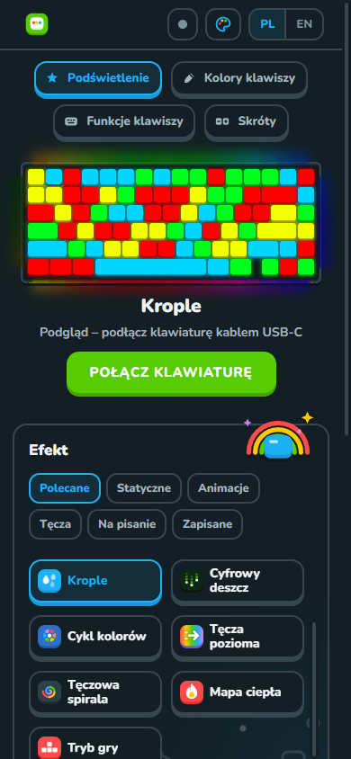

# KeyGlow

Prosta apka do podświetlenia i funkcji klawiszy w klawiaturze **NuPhy Halo75 V2** (ANSI). Po polsku i po angielsku.

*Lighting, per-key colours and key remapping for the NuPhy Halo75 V2. Runs in the browser and on Windows, macOS and Linux.*

Zrobiłem ją, bo normalnie nie da się tego wygodnie ustawić: VIA nie ma tej klawiatury na liście, a z plikami JSON jest tylko kombinowanie. Tutaj podłączasz klawiaturę i po prostu klikasz.

**[Otwórz KeyGlow w przeglądarce](https://krystianrodziewicz.github.io/KeyGlow/)**



| Kolory klawiszy | Funkcje klawiszy |
| --- | --- |
|  |  |

<p align="center"></p>

## Co umie

- zmienia efekt (43 efekty w kilku zakładkach), kolor, jasność i prędkość
- **kolory klawiszy**: zaznaczasz kursorem dowolne klawisze i dajesz im własny kolor
- **funkcje klawiszy**: klikasz klawisz i zmieniasz, co robi (np. Caps Lock jako Esc), osobno dla Windowsa i Maca
- **zapisane ustawienia**: gotowe zestawy (np. Czerwień, Biały do pracy, Matrix) i Twoje własne, pod dowolną nazwą
- **skróty**: lista wszystkich skrótów Fn i Fn + M, odczytana z Twojej klawiatury
- wyłącza i włącza pasek dookoła obudowy, także na fabrycznym firmware
- od razu pokazuje, jak to wygląda na klawiaturze
- wszystko zapisujesz przyciskiem **Zapisz** (albo Ctrl+S), a przycisk **Przywróć domyślne** przywraca fabryczne podświetlenie NuPhy
- kilka motywów kolorystycznych (Morski, Fiolet, Wiśnia, Grafit, Las)

Tylko w wersji na komputer:

- pokazuje, jak klawiatura jest podłączona (kabel, odbiornik 2.4 GHz albo Bluetooth) i ile ma baterii przy Bluetooth
- po podłączeniu sama wgrywa zapisane ustawienia
- włącza się razem z systemem i siedzi cicho przy zegarze (wyłączysz to prawym kliknięciem na ikonę przy zegarze → **Uruchamiaj razem z systemem**)

## Jak zainstalować

### W przeglądarce

Otwórz **[krystianrodziewicz.github.io/KeyGlow](https://krystianrodziewicz.github.io/KeyGlow/)** w Chrome, Edge albo Operze, kliknij **Połącz klawiaturę** i wybierz Halo75 V2. Firefox i Safari nie obsługują WebHID, więc tam to nie zadziała.

W Chrome i Edge możesz też kliknąć **Zainstaluj** w prawym górnym rogu. KeyGlow pojawi się wtedy na liście aplikacji jak zwykły program i będzie działać bez internetu. Nie pobierasz żadnego pliku `.exe`, więc Windows niczego nie blokuje. W Edge przy instalacji możesz od razu zaznaczyć uruchamianie razem z systemem. Na Linuksie potrzebna jest jeszcze reguła udev z sekcji niżej.

### Wersja na komputer

Pobierasz ją z [Releases](../../releases).

| System | Plik |
| --- | --- |
| Windows (instalator) | `KeyGlow-Setup-….exe` |
| Windows (bez instalacji) | `KeyGlow-…-portable.exe` |
| macOS 13 lub nowszy, M1 i nowsze | `KeyGlow-…-arm64.dmg` |
| macOS 13 lub nowszy, Intel | `KeyGlow-…-x64.dmg` |
| Ubuntu / Debian | `keyglow_…_amd64.deb` |
| inny Linux | `KeyGlow-….AppImage` |

Potem podłącz klawiaturę **kablem USB-C** i przestaw przełącznik trybu na kabel. Apka sama ją znajdzie.

**Windows:** jeśli pojawi się niebieskie okno SmartScreen, kliknij „Więcej informacji”, a potem „Uruchom mimo to”. Jeśli masz włączoną **Inteligentną kontrolę aplikacji** (Smart App Control), Windows nie uruchomi pliku `.exe`, bo nie ma płatnego podpisu. Wtedy użyj wersji w przeglądarce.

**macOS:** przy pierwszym uruchomieniu wejdź w Ustawienia systemowe → Prywatność i ochrona i kliknij „Otwórz mimo to” (apka nie ma płatnego podpisu od Apple). Na pytanie o Bluetooth odpowiedz „Pozwól”, wtedy apka pokaże baterię.

**Linux:** przy `.deb` wszystko dzieje się samo. Przy AppImage i wersji w przeglądarce raz dodaj regułę, żeby był dostęp do klawiatury, i podłącz ją ponownie:

```bash
sudo cp build/linux/50-keyglow.rules /etc/udev/rules.d/ && sudo udevadm control --reload-rules && sudo udevadm trigger
```

Na Ubuntu AppImage potrzebuje jeszcze `libfuse2` (na 24.04 `libfuse2t64`).

## Firmware z paskiem

Na fabrycznym firmware apka umie tylko włączyć i wyłączyć pasek dookoła obudowy. Żeby ustawiać jego tryb, kolor, jasność i prędkość, wgraj [firmware z paskiem](firmware/) (kod NuPhy w wersji SRGBmods plus moja łatka). Wszystko jest opisane w [firmware/README.md](firmware/README.md), razem z powrotem do fabrycznego.

## Dobrze wiedzieć

- podświetlenie da się zmieniać tylko po kablu, z przełącznikiem trybu ustawionym na kabel. Przez 2.4 GHz i Bluetooth klawiatura nie przyjmuje ustawień, ale po zapisaniu możesz wrócić do bezprzewodowego, ustawienia zostają w klawiaturze
- procent baterii apka pokazuje przy Bluetooth. Przy kablu klawiatura się ładuje i firmware go nie podaje, więc apka pokazuje ostatni procent z Bluetooth. Na samej klawiaturze odłącz kabel i naciśnij Fn + \: zielony to powyżej 80%, żółty 51–80%, pomarańczowy 21–50%, czerwony do 20%, a poniżej 10% pasek miga
- na fabrycznym firmware tryb i kolor paska zmieniasz skrótami Fn + M + strzałki (możesz je też przypisać do innych klawiszy w „Funkcjach klawiszy”). Jeśli przygasisz pasek do zera skrótem, zmiana efektu w apce zapali go z powrotem na średnim poziomie, tak działa firmware NuPhy
- kolorów pojedynczych klawiszy nie da się zapisać w samej klawiaturze, więc pamięta je apka i wgrywa po podłączeniu
- to nie jest oficjalna aplikacja NuPhy

## Dla programistów

Potrzebny jest Node.js 22.

```bash
npm install
npm start
```

- `npm run web` uruchamia wersję w przeglądarce na lokalnym serwerze
- `npm run dist` robi instalator dla systemu, na którym jesteś (folder `dist`)
- `npm run dist:store -- "-c.appx.identityName=…" "-c.appx.publisher=CN=…"` robi paczkę do Microsoft Store (dane z Partner Center)
- `npm run icon` rysuje wszystkie ikony z `src/assets/logo.svg`

## Licencja

[MIT](LICENSE) dla kodu apki. Łatka w `firmware/` i zbudowany z niej plik `.bin` są na licencji GPL-2.0-or-later, tak jak QMK. Czcionka Nunito ma licencję SIL OFL 1.1 ([`src/assets/fonts/OFL.txt`](src/assets/fonts/OFL.txt)).
